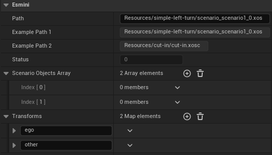

# GEMSTAR UE_esmini_plugin

[](https://www.dlr.de/en/ts/about-us/the-institute-of-transportation-systems)

The esmini plugins enables GEMSTAR to use [esmini](https://github.com/esmini/esmini) as a scenario runner.

## Input

- OpenScenario file

## Output

- Vehicle Data Update

# Getting started

First clone the GEMSTAR Interfaces plugin to Plugins directory of the Unreal project.

Add the plugin to your Unreal project:

```sh
mkdir Plugins/Gamefeatures
cd Plugins/Gamefeatures

git clone <this repo>
```
or:
```sh
git submodule add <this repo>
```

# Configuration

You can configure the OpenScenario file to be played by setting the Path variable of EsminiManager actor.

# Test



A test map is provided in the Content directory.
It shows the transforms of the vehicles changing during the simulation.

---------------
**Contact:** opensource-ts@dlr.de

This project uses [esmini](https://github.com/esmini/esmini), which is licensed under the
Mozilla Public License 2.0.